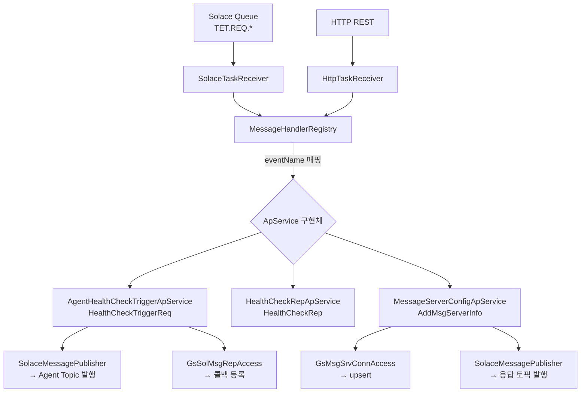
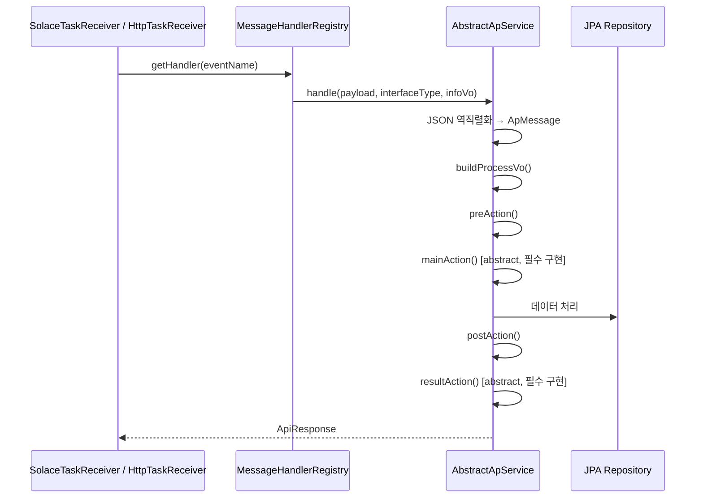
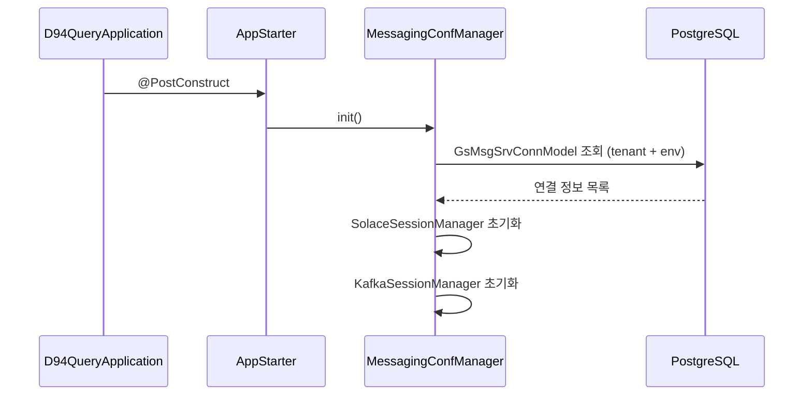

# d94-query — 애플리케이션 서버

## 프로젝트 개요

| 항목              | 내용                                                               |
|-------------------|--------------------------------------------------------------------|
| **역할**          | D94 실행 가능한 Spring Boot 앱 서버                               |
| **GroupId**       | `tsh.d94`                                             |
| **ArtifactId**    | `d94-query`                                                        |
| **Version**       | `1.0.0-SNAPSHOT`                                                   |
| **Parent**        | `d94:1.0-SNAPSHOT`                                                |
| **핵심 의존성**   | `d94-lib-core:1.0.0-SNAPSHOT`                                     |
| **Base Package**  | `tsh.d94.app.server`                                  |
| **Scan Packages** | `tsh.d94.lib.core`, `tsh.d94.query`, `tsh.d94.app.server` (QueryApplication 은 `tsh.d94.query`, 나머지 클래스 선언은 `tsh.d94.app.server`) |

---

## 폴더 및 파일 생성 규칙

- App 모듈은 단위 서비스에 대한 개발 수행
- 모든 파일이나 폴더는 단위 서비스로 식별이 가능해야함
- 주요 폴더
    - 데이터 관련 폴더 및 파일
        - 경로
            - tsh/d94/app/server/data/orm
        - 기준
            1. 단위 서비스에서 생성되는 폴더는 서비스명으로 구분
                - 단위 서비스별 data 접근은 서비스명 기준으로 구분되야함
                - ex) custom jira 프로젝트는 cira로 관련한 파일은 cira 폴더 하위에 생성되야함
            2. 폴더는 테이블 이름의 prefix를 제외한 글자의 camel-case로 생성
                - ex) ST_ORG_WRKR_REL: stOrgWrkRel 로 표현
            3. 각 파일 성격에 따른 파일 명
                - JPA Service
                    - 기본 테이블 명 뒤에 "Access" 로 파일 명 생성
                        - ex) GS_SOL_MSG_REP 테이블의 JPA Service: GsSolMsgRepAccess
                - Entity
                    - 기본 테이블 명 뒤에 "Model" 로 파일 명 생성
                        - ex) GS_SOL_MSG_REP 테이블의 Entity: GsSolMsgRepModel
                - Jpa Repository
                    - 기본 테이블 명 뒤에 "Repo" 로 파일 명 생성
                        - ex) GS_SOL_MSG_REP Jpa Repository: GsSolMsgRepRepo
            4. 유형별 네이밍
                - 클래스: 첫 글자 대문자로 생성
                - 폴더: 첫 글자는 소문자로 생성

  ---

## 데이터 처리 개발론

- apService 죽 biz 로직을 처리하는 Service에서는 data의 Access Service Layer를 통해서만 데이터 작업을 한다.
- apService에서 JPA Repository를 통해 직접적으로 데이터를 조회하면 안된다.

---

## 메시지 처리 아키텍처

---

## 핵심 컴포넌트

### ApService 처리 흐름

### MessageHandlerRegistry

- `List<ApService<?,?>>` 자동 주입 후 `getSupportedEvent()` → `ApMessageList` 기반 Map 구성
- 등록된 이벤트 외 요청 시 `IllegalArgumentException` 발생

---

## 구현된 ApService 목록

| 서비스 클래스                      | 이벤트                  | 역할                                                  |
|------------------------------------|-------------------------|-------------------------------------------------------|
| `AgentHealthCheckTriggerApService` | `HealthCheckTriggerReq` | UI 트리거 수신 → Agent 헬스체크 요청 발행 → 콜백 등록 |
| `HealthCheckRepApService`          | `HealthCheckRep`        | Agent 헬스체크 응답 수신 처리                         |
| `MessageServerConfigApService`     | `AddMsgServerInfo`      | 메시징 서버 연결정보 upsert → 요청자에게 결과 발행    |

---

## 인터페이스 계층

### Solace 수신 (`SolaceTaskReceiver`)

| 항목         | 내용                                         |
|--------------|----------------------------------------------|
| 구독 큐 패턴 | `TET.REQ.*` (SolaceQueueDiscovery 자동 탐색) |
| 접근 타입    | `ACCESSTYPE_EXCLUSIVE`                       |
| 메시지 헤더  | `eventName`, `responseTopic`, `selectorKey`  |
| 처리 방식    | 동기 처리 (Tomcat 컨트롤러와 동일)           |

### HTTP 수신 (`HttpTaskReceiver`)

- `ApMessageList` 이벤트 기반 라우팅
- `InterfaceType.HTTP`로 처리 컨텍스트 구분

### REST API 엔드포인트

| 컨트롤러                        | 경로 (추정)              | 역할                  |
|---------------------------------|--------------------------|-----------------------|
| `MessageServerConfigController` | `/mdm/msg-server-config` | 메시징 서버 설정 CRUD |
| `ConfigManageController`        | `/mdm/config`            | 설정 관리             |
| `MessageOutboundController`     | `/util/message-outbound` | 메시지 수동 발행 유틸 |
| `AuthController`                | `/api/v1/auth`           | lib-core `BaseAuthController`(register·login·refresh·logout) + `GET /public-key`. login·register 본문은 암호화 봉투 `{enc}` 만 받음 (아래 "자격 증명 암호화") |
| `InterfaceTestController`       | `/api/v1/interface-tests` | 인터페이스(통신) 테스트 CRUD — GET·HEAD·POST(201)·PUT·PATCH·DELETE(204) |
| `GlobalExceptionHandler`        | —                        | 전역 예외 처리        |

### 자격 증명 암호화 (로그인·회원가입)

설계: d94-web `docs/decisions/0004-credential-encryption.md`

| 클래스 | 역할 |
|---|---|
| `apService/auth/CredentialCryptoService` | RSA 키(`AUTH_CREDENTIAL_PRIVATE_KEY`, 없으면 임시 키) 보관, 공개키·`kid` 제공, 봉투 복호화(RSA-OAEP SHA-256/MGF1-SHA256 + AES-256-GCM, AAD `d94-auth:v1:{login\|register}`), `ts` 허용 범위(`max-age-seconds`, 기본 300)·`nonce` 재사용(인메모리) 검사 |
| `interfaces/controller/auth/EncryptedCredentialBodyAdvice` | `RequestBodyAdvice`. `LoginRequest`·`RegisterRequest` 본문 `{enc}` 를 lib-core 로 넘기기 전에 평문 JSON 으로 교체. 평문 본문은 `allow-plaintext=false` 면 거절 |
| `apService/auth/CredentialInvalidException` | → `GlobalExceptionHandler` 400 `AUTH_CREDENTIAL_INVALID` (사유는 로그에만) |

- 비밀번호 저장은 lib-core `AuthService.register` 의 BCrypt(12) 그대로. lib-core 는 수정하지 않음.
- 설정: `application.security.credential.{private-key, max-age-seconds, allow-plaintext}` ← `AUTH_CREDENTIAL_PRIVATE_KEY`, `AUTH_CREDENTIAL_MAX_AGE_SECONDS`, `AUTH_CREDENTIAL_ALLOW_PLAINTEXT`
- 테스트: `CredentialCryptoServiceTest`(d94-web 모듈이 만든 픽스처 `src/test/resources/credential/web-envelope-fixture.json` 복호화 포함 — 픽스처 키는 테스트 전용), `EncryptedCredentialBodyAdviceTest`

### DTO

| 클래스            | 방향 | 용도                                 |
|-------------------|------|--------------------------------------|
| `GnMsgSrvConnReq` | 요청 | 메시징 서버 연결 정보 생성·수정 요청 |
| `GnMsgSrvConnRes` | 응답 | 메시징 서버 연결 정보 조회 응답      |

---

## 데이터 계층

### ORM (app-server 전용 도메인)

| 패키지                  | 내용                                                                                       |
|-------------------------|--------------------------------------------------------------------------------------------|
| `data/orm/masterPrompt` | `StMptTmpltDefModel` (마스터 프롬프트 템플릿), `StMptWrkrTmpltRelModel` (워커-템플릿 관계) |
| `data/orm/organization` | `StOrgUnitDefModel` (조직단위 정의), `StOrgWrkrRelModel` (조직-워커 관계)                  |
| `data/orm/ifTest`      | `SnIfTestItemModel`·`SnIfTestItemAccess`·`SnIfTestItemRepo` (`SN_IF_TEST_ITEM`, V300 마이그레이션) — UI→UMD→백엔드→DB 통신 확인용 |

### 상수

| 클래스        | 값                               |
|---------------|----------------------------------|
| `ApTableName` | app-server 전용 테이블 이름 상수 |
| `OrgUnitTyp`  | 조직단위 유형 Enum               |
| `TemplateTyp` | 프롬프트 템플릿 유형 Enum        |

---

## 앱 기동 흐름

---

## 환경 설정

| 설정        | 값 / 방식                                                                         |
|-------------|-----------------------------------------------------------------------------------|
| DB URL      | `jdbc:postgresql://${DB_HOST:localhost}:${DB_PORT:5432}/${DB_NAME}`               |
| DB 인증     | `.env` 파일 (`DB_USERNAME`, `DB_PASSWORD`)                                        |
| Solace 연결 | DB에서 동적 로드 (`GsMsgSrvConnModel`)                                            |
| Eureka      | `spring-cloud-starter-netflix-eureka-client` (Spring Cloud `2024.0.1`). 서비스 ID `d94-query`. `EUREKA_ENABLED`(yml 기본 false, compose 기본 true), `EUREKA_URL`, `EUREKA_INSTANCE_HOSTNAME`(컨테이너 이름 등록, `prefer-ip-address: false`) |
| Gateway     | delap `gateway-cloud-gateway-1` 이 `lb://d94-query`, `Path=/tsh/**` 로 호출 (게이트웨이 저장소 설정) |
| Docker 네트워크 | compose 가 external `CLOUD_NETWORK_NAME`(`befw-cloud-network`)·`DB_NETWORK_NAME`(`tsh-network`) 에 붙음 |
| Swagger UI  | `/swagger-ui.html`                                                                |
| API Docs    | `/v3/api-docs`                                                                    |
| 로그 설정   | `log4j2-spring.xml`. 표시 시간대는 env `LOG_TZ`(기본 UTC, compose 기본 `America/New_York`). JVM `TZ` 는 바꾸지 않음 |
| 버전 주입   | Maven Resource Filtering (`@project.version@`, `@module-name@`, `@service-name@`) |

---

## 미정의 항목 (정의 필요)

| #  | 항목                                   | 현재 상태                                                                         |
|----|----------------------------------------|-----------------------------------------------------------------------------------|
| 1  | `HealthCheckRepApService.mainAction()` | 구현 내용 미확인 (파일 미검토)                                                    |
| 2  | `AppStarter` 기동 로직                 | 파일 존재하나 구체적 초기화 작업 미확인                                           |
| 3  | `masterPrompt` 도메인 비즈니스 로직    | Entity만 존재, Service·Repository 미구현                                          |
| 4  | `organization` 도메인 비즈니스 로직    | Entity만 존재, Service·Repository 미구현                                          |
| 5  | Agent Topic 이름                       | `"AGENT_TOPIC_NAME"` 하드코딩, 설정화 필요                                        |
| 6  | `resultAction()` 응답 객체             | `MessageServerConfigApService.resultAction()` `null` 반환 (TODO 주석)             |
| 7  | Custom 예외 처리                       | `AbstractApService.execute()`에 TODO 주석 (`ApService custom exception required`) |
| 8  | `TestController` 운영 비활성화 방안    | 운영 환경 노출 제어 미정의                                                        |
| 9  | HTTP 인증·인가                         | lib-core `SecurityConfig`(JWT, `/api/v1/auth/**` permitAll). 역할은 USER 고정(TODO). 로그인·가입 본문은 암호화 필수 |
| 10 | `SolaceMessageInfoVo.msgObject` 보관   | `BytesXMLMessage` 직접 보관 시 메모리 해제 정책 미정의                            |
| 11 | `AbstractCrudService.findById` (lib-core) | `TenantContext` 를 채우는 곳이 없어 HTTP 요청에서 항상 실패(500). ifTest 는 tenant 를 인자로 받는 Repo 메서드로 우회 |
| 12 | 패키지 선언 ↔ 폴더 불일치               | 파일은 `tsh/d94/query/**` 폴더, 선언은 `tsh.d94.app.server.*`. 스캔에 두 패키지를 모두 넣어 동작은 함 |
| 13 | 기존 테스트 실패 2건                    | `AuthControllerTest`(@SpringBootConfiguration 못 찾음), `CommentServiceTest`(UnnecessaryStubbing) |
| 14 | 토큰 없는 보호 API 호출                 | 401 이 아니라 403 응답 (SecurityConfig 에 AuthenticationEntryPoint 없음) |
