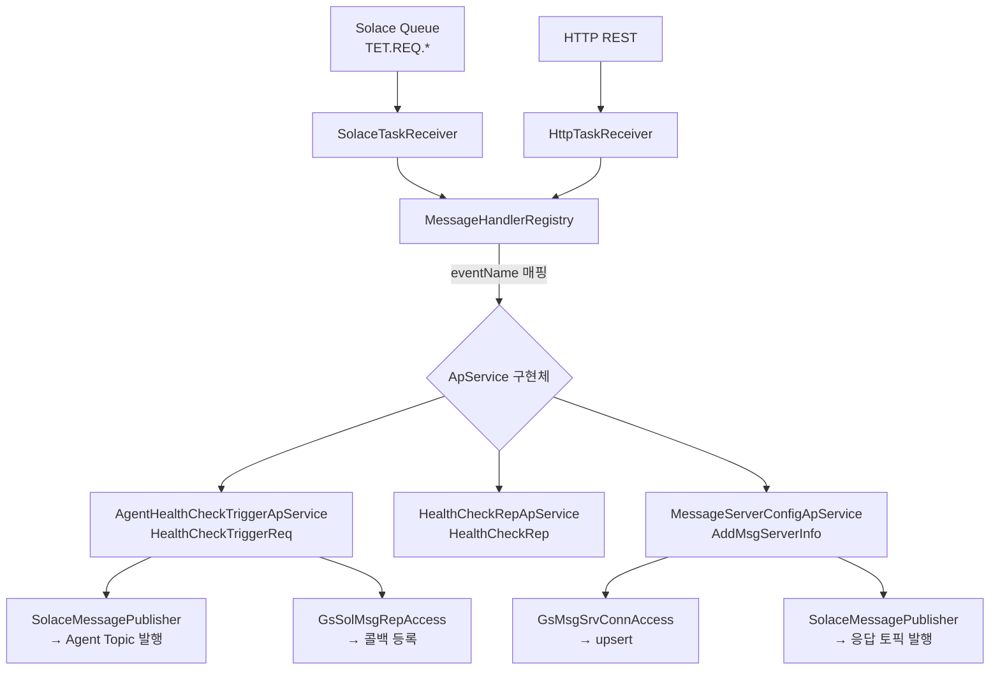
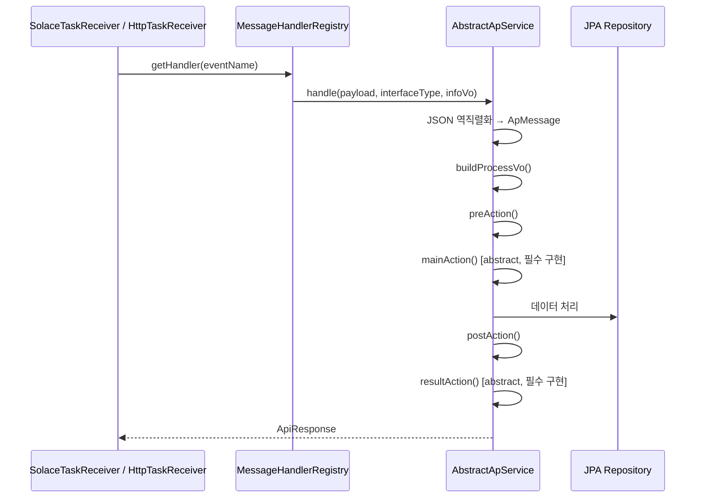
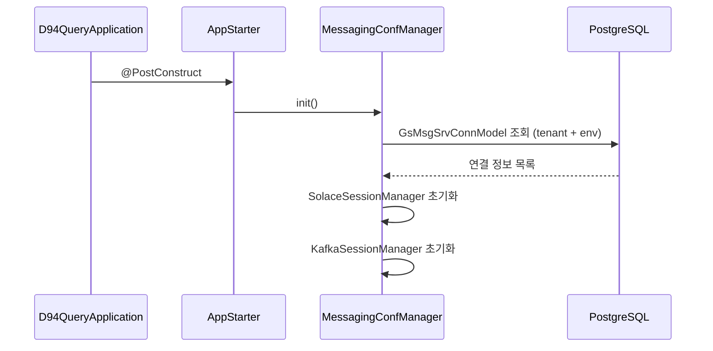

# d94-query — 애플리케이션 서버

## PDF 학습 읽기 도움

- `/api/v1/study/dictionary`는 로그인 소유자의 Merriam-Webster 키와 사용자별 단어 응답 캐시를 사용합니다. 키 상태 DTO에는 원문을 절대 넣지 않습니다.
- 키는 기존 `GitRepositoryService` AES 암복호화를 재사용합니다. 사전 호출 실패는 캐시하지 않고 `NOT_FOUND`도 캐시합니다.
- `/api/v1/study/documents/{id}/pages/{pageSectionId}/syntax`는 d94-app-pdf `/pdf/api/v1/syntax` 결과를 `SN_STUDY_SYNTAX`에 저장합니다(조회는 분석기 버전을 무시, 업그레이드 시 테이블을 비웁니다).
- 테이블 `SN_STUDY_DICTIONARY_KEY`, `SN_STUDY_DICTIONARY`, `SN_STUDY_SYNTAX`. 엔드포인트 `GET/PUT/DELETE /api/v1/study/dictionary/key`, `GET /api/v1/study/dictionary?word=`.
- 운영에서는 반드시 `cira.git.encryption-key`를 설정합니다(미설정 시 키가 평문 저장). 나중에 설정하면 이미 저장된 키를 복호화할 수 없으므로 사용자가 키를 다시 등록해야 합니다.
- 관련 마이그레이션: `V550__study_reading_aids.sql`.

## 프로젝트 개요

| 항목              | 내용                                                               |
|-------------------|--------------------------------------------------------------------|
| **역할**          | D94 실행 가능한 Spring Boot 앱 서버                               |
| **GroupId**       | `tsh.d94`                                             |
| **ArtifactId**    | `d94-query`                                                        |
| **Version**       | `1.0.0-SNAPSHOT`                                                   |
| **Parent**        | `d94:1.0-SNAPSHOT`                                                |
| **핵심 의존성**   | `d94-lib-core:1.0.0-SNAPSHOT`                                     |
| **Base Package**  | `tsh.d94.app.server`                                  |
| **Scan Packages** | `tsh.d94.lib.core`, `tsh.d94.query`, `tsh.d94.app.server` (QueryApplication 은 `tsh.d94.query`, 나머지 클래스 선언은 `tsh.d94.app.server`) |

---

## 폴더 및 파일 생성 규칙

- App 모듈은 단위 서비스에 대한 개발 수행
- 모든 파일이나 폴더는 단위 서비스로 식별이 가능해야함
- 주요 폴더
    - 데이터 관련 폴더 및 파일
        - 경로
            - tsh/d94/app/server/data/orm
        - 기준
            1. 단위 서비스에서 생성되는 폴더는 서비스명으로 구분
                - 단위 서비스별 data 접근은 서비스명 기준으로 구분되야함
                - ex) custom jira 프로젝트는 cira로 관련한 파일은 cira 폴더 하위에 생성되야함
            2. 폴더는 테이블 이름의 prefix를 제외한 글자의 camel-case로 생성
                - ex) ST_ORG_WRKR_REL: stOrgWrkRel 로 표현
            3. 각 파일 성격에 따른 파일 명
                - JPA Service
                    - 기본 테이블 명 뒤에 "Access" 로 파일 명 생성
                        - ex) GS_SOL_MSG_REP 테이블의 JPA Service: GsSolMsgRepAccess
                - Entity
                    - 기본 테이블 명 뒤에 "Model" 로 파일 명 생성
                        - ex) GS_SOL_MSG_REP 테이블의 Entity: GsSolMsgRepModel
                - Jpa Repository
                    - 기본 테이블 명 뒤에 "Repo" 로 파일 명 생성
                        - ex) GS_SOL_MSG_REP Jpa Repository: GsSolMsgRepRepo
            4. 유형별 네이밍
                - 클래스: 첫 글자 대문자로 생성
                - 폴더: 첫 글자는 소문자로 생성

  ---

## 데이터 처리 개발론

- apService 죽 biz 로직을 처리하는 Service에서는 data의 Access Service Layer를 통해서만 데이터 작업을 한다.
- apService에서 JPA Repository를 통해 직접적으로 데이터를 조회하면 안된다.

---

## 메시지 처리 아키텍처

---

## 핵심 컴포넌트

### ApService 처리 흐름

### MessageHandlerRegistry

- `List<ApService<?,?>>` 자동 주입 후 `getSupportedEvent()` → `ApMessageList` 기반 Map 구성
- 등록된 이벤트 외 요청 시 `IllegalArgumentException` 발생

---

## 구현된 ApService 목록

| 서비스 클래스                      | 이벤트                  | 역할                                                  |
|------------------------------------|-------------------------|-------------------------------------------------------|
| `AgentHealthCheckTriggerApService` | `HealthCheckTriggerReq` | UI 트리거 수신 → Agent 헬스체크 요청 발행 → 콜백 등록 |
| `HealthCheckRepApService`          | `HealthCheckRep`        | Agent 헬스체크 응답 수신 처리                         |
| `MessageServerConfigApService`     | `AddMsgServerInfo`      | 메시징 서버 연결정보 upsert → 요청자에게 결과 발행    |

---

## 인터페이스 계층

### Solace 수신 (`SolaceTaskReceiver`)

| 항목         | 내용                                         |
|--------------|----------------------------------------------|
| 구독 큐 패턴 | `TET.REQ.*` (SolaceQueueDiscovery 자동 탐색) |
| 접근 타입    | `ACCESSTYPE_EXCLUSIVE`                       |
| 메시지 헤더  | `eventName`, `responseTopic`, `selectorKey`  |
| 처리 방식    | 동기 처리 (Tomcat 컨트롤러와 동일)           |

### HTTP 수신 (`HttpTaskReceiver`)

- `ApMessageList` 이벤트 기반 라우팅
- `InterfaceType.HTTP`로 처리 컨텍스트 구분

### REST API 엔드포인트

| 컨트롤러                        | 경로 (추정)              | 역할                  |
|---------------------------------|--------------------------|-----------------------|
| `MessageServerConfigController` | `/mdm/msg-server-config` | 메시징 서버 설정 CRUD |
| `ConfigManageController`        | `/mdm/config`            | 설정 관리             |
| `MessageOutboundController`     | `/util/message-outbound` | 메시지 수동 발행 유틸 |
| `AuthController`                | `/api/v1/auth`           | lib-core `BaseAuthController`(register·login·refresh·logout) + `GET /public-key`. login·register 본문은 암호화 봉투 `{enc}` 만 받음 (아래 "자격 증명 암호화") |
| `StudyController`               | `/api/v1/study`          | PDF 학습 뷰어 — 분할 업로드(`documents/uploads`, 조각 768KB), 문서·목차·페이지·그림, 단어장(`terms`), 마킹·노트(`annotations`). 아래 "PDF 학습 뷰어" |
| `DocsController`                | `/api/v1/docs`           | Docs 다중 vault(`GET /vaults`, 목록·Task·titles 에 `vaultId`, 생략·`ALL`=통합 뷰) — 폴더·노트 CRUD·이동, 목록 필터·titles·by-title, 버전·백링크, 진화(derive·kind·lineage), 그래프(`GET /graph?vaultId=&noteId=&depth=`), Task(`tasks`, 상태 변경·노트 승격). 아래 "Docs" |
| `LifeMetricController`          | `/api/v1/life-metric`    | Life Metric(삶의 수치화) — 템플릿, 지표 CRUD, 기준값(`inputs`), 시계열 로그(`logs`), 평가(`evaluate`), 저장 전 미리보기(`preview`). 아래 "Life Metric" |
| `InterfaceTestController`       | `/api/v1/interface-tests` | 인터페이스(통신) 테스트 CRUD — GET·HEAD·POST(201)·PUT·PATCH·DELETE(204) |
| `GlobalExceptionHandler`        | —                        | 전역 예외 처리        |

### 자격 증명 암호화 (로그인·회원가입)

설계: d94-web `docs/decisions/0004-credential-encryption.md`

| 클래스 | 역할 |
|---|---|
| `apService/auth/CredentialCryptoService` | RSA 키(`AUTH_CREDENTIAL_PRIVATE_KEY`, 없으면 임시 키) 보관, 공개키·`kid` 제공, 봉투 복호화(RSA-OAEP SHA-256/MGF1-SHA256 + AES-256-GCM, AAD `d94-auth:v1:{login\|register}`), `ts` 허용 범위(`max-age-seconds`, 기본 300)·`nonce` 재사용(인메모리) 검사 |
| `interfaces/controller/auth/EncryptedCredentialBodyAdvice` | `RequestBodyAdvice`. `LoginRequest`·`RegisterRequest` 본문 `{enc}` 를 lib-core 로 넘기기 전에 평문 JSON 으로 교체. 평문 본문은 `allow-plaintext=false` 면 거절 |
| `apService/auth/CredentialInvalidException` | → `GlobalExceptionHandler` 400 `AUTH_CREDENTIAL_INVALID` (사유는 로그에만) |

- 비밀번호 저장은 lib-core `AuthService.register` 의 BCrypt(12) 그대로. lib-core 는 수정하지 않음.
- 설정: `application.security.credential.{private-key, max-age-seconds, allow-plaintext}` ← `AUTH_CREDENTIAL_PRIVATE_KEY`, `AUTH_CREDENTIAL_MAX_AGE_SECONDS`, `AUTH_CREDENTIAL_ALLOW_PLAINTEXT`
- 테스트: `CredentialCryptoServiceTest`(d94-web 모듈이 만든 픽스처 `src/test/resources/credential/web-envelope-fixture.json` 복호화 포함 — 픽스처 키는 테스트 전용), `EncryptedCredentialBodyAdviceTest`

### API 토큰 (MCP·AI 도구)

설계: d94-note `feature/user/3_api_token/api-token-plan.md`

| 클래스 | 역할 |
|---|---|
| `config/ApiTokenSecurityConfig` | `@Order(2)` 체인. `Authorization: Bearer d94_…` 요청만 매칭. 필터는 `@Bean` 아님(서블릿 전역 자동 등록 방지). 성공 시 소유자 `D94UserDetails`·`TenantContext` 설정, 실패는 JSON `ApiResponse` 401/403 |
| `apService/apiToken/ApiTokenScope` | 서비스별 허용 경로(context-path 제외): `CIRA`, `DOCS`(`/api/v1/docs`), `STUDY`(`/api/v1/study`), `INTERFACE_TEST`(`/api/v1/interface-tests`), `LIFE_METRIC`(`/api/v1/life-metric`), 전역 `ALL`(위 서비스 전체 — 서비스를 추가하면 자동 포함). 목록 밖(`/api-tokens`·`/settings`·`/auth`·`/internal`·`/api/mdm` 등)은 전역 토큰도 403 |
| `apService/apiToken/ApiTokenService` | 발급(원문 1회, `SHA-256` hex 저장, 이름 1~100자, READ/WRITE, 30·90·365일, 사용자당 사용 중 20개), 조회, 폐기(`REVOKED_AT`), 서비스 on/off(`SN_SETTING` `api-token.{service}.enabled`, 없으면 허용), 요청 인증 |
| `interfaces/controller/apiToken/ApiTokenController` | `GET·POST /api/v1/api-tokens`, `DELETE /{id}`(204, 남의 것 404), `GET /services`, `PUT /services/{service}` `{enabled}`(ADMIN) |

- 토큰 형식 `d94_{service}_{base64url 32바이트}`. 토큰은 **발급 사용자로 동작**하므로 CIRA 권한 검사를 그대로 받는다(조회 권한이 열린 결함 [D18] 도 그대로).
- 401: 없음·불일치·만료·폐기·소유자 `USE_STAT_CD≠Usable`. 403: 서비스 꺼짐·범위 밖·READ 토큰으로 GET/HEAD 외.
- 전역 토큰(`d94_all_…`)은 `api-token.all.enabled` 와 **호출하는 서비스의** `api-token.{service}.enabled` 가 둘 다 켜져 있어야 통과(서비스 차단을 전역 토큰으로 우회 못 함). Ayaan 은 별도 앱(자체 JWT)이라 대상 아님.
- `LAST_USED_AT` 은 1분에 한 번만 갱신. 로그에는 토큰 원문 대신 `d94_{service}_…` 만.
- MCP 는 UMD 를 거치지 않고 게이트웨이(`/tsh/**`)로 바로 호출(UMD 는 JWT 만 통과).
- 테이블 `SN_API_TOKEN` (`V560`). 테스트: `ApiTokenScopeTest`, `ApiTokenIT`(실제 필터 체인).

### CIRA 프로젝트 타입·필드·컬럼

설계: d94-note `docs/superpowers/specs/2026-11-21-cira-task-columns-design.md` (테이블 `V590`)

| 클래스 | 역할 |
|---|---|
| `apService/cira/CiraFieldService` | 기본 필드 카탈로그(`sys:*`, d94-web mock `src/lib/mock/fields.ts` 와 짝), 작업 공간 프리셋(구 프로젝트 타입)·프리셋별 필드 세트, 사용자 정의 필드(`cf:<id>`, 전역·프로젝트), 유효 필드(고정 → 공간 필드 세트), 사람별 목록 컬럼(`KNOWN_KEYS` 로 새 필드 감지), Task 값 검증·저장 |
| `apService/cira/IssueSort` | `sort=sys:<key>,asc` 를 보이는 값 기준으로 정렬, 빈 값은 항상 뒤 |
| `data/orm/cira/ciraField/CiraFieldAccess` | 위 테이블들의 JdbcTemplate 저장소 (엔티티 없음) |
| `interfaces/controller/cira/CiraFieldController` | `/api/v1/cira/{field-catalog,project-types,custom-fields}`(쓰기 ADMIN), `/api/v1/projects/{id}/{fields,custom-fields,column-pref}`(쓰기 프로젝트 ADMIN, 컬럼은 본인) |

- (V660) 프로젝트에는 타입이 없다(`SN_CIRA_PROJECT.PROJECT_TYPE`·`PROJECT_TYPE_ID` 삭제). `SN_CIRA_PROJECT_TYPE` 은 작업 공간 스타터 프리셋일 뿐이고, 공간이 고른 프리셋은 `SN_CIRA_SPACE.PRESET_TYPE_ID`(참고용, 만든 뒤 연결 없음). 프리셋 사용 수 = 그 프리셋으로 만든 공간 수(`spaceCount`), 써도 삭제 가능(공간 `PRESET_TYPE_ID` 만 비움). 프로젝트 생성 요청의 `spaces`(처음 만들 공간 목록, 첫 번째 = 기본 공간, 공간마다 프리셋 또는 빈 공간, 관리자 = 만든 사람, 최대 10개, 이름 중복 400)가 있으면 그대로 만들고, 없으면 `presetTypeId`(옛 이름 `projectTypeId`)·`presetTypeNm`(옛 `projectType`)·`defaultSpaceName` 으로 기본 공간 1개. 이름에서 만든 공간 키가 겹치면 `_2`, `_3` 을 붙인다(한글 이름은 모두 `SPACE`). 기준정보 키 `cira.project.types` 는 없어졌다.
- (V650) 새 프로젝트는 고른 프리셋으로 기본 작업 공간 1개를 만든다(보드 유형도 프리셋 `BOARD_TYPE`). Task 기본 세부 유형은 `Issue`(V590 에서 `Task` 이름 변경).
- 사용자 정의 필드 소속(V600): 전역(`PROJECT_ID`·`PROJECT_TYPE_ID` null) · 타입(`PROJECT_TYPE_ID`) · 프로젝트(`PROJECT_ID`). 전역·타입 필드는 라이브러리이고, 가져가면 **복사본**(`SOURCE_FIELD_ID`=원본, FK 없음)이 생겨 원본 수정·삭제와 무관하다. 타입 세트에는 `sys:` 와 그 타입의 타입 필드만. 라이브러리(`/field-library`) = 전역 + **모든 프리셋의 필드** — 공간은 어느 프리셋 필드든 가져온다, 다른 프로젝트 필드는 404.
- 프로젝트 필드 생성·가져오기(`/projects/{id}/custom-fields[/import]`, `/field-library`)는 프로젝트 멤버, 수정·삭제는 `CREATED_BY` 본인 또는 프로젝트 ADMIN.
- 테스트: `CiraFieldIT`, `CiraFieldLibraryMigrationIT`(V600 참조 → 복사 이관, 옛 `PROJECT_TYPE_ID` 칼럼을 잠시 되살려 재실행).

### CIRA 작업 공간(Space) · 2단계 Feature · 산출물 규칙 3단계

설계: DOCS 노트 "CIRA 작업 공간(Space) · Feature · Docs 중심 개편 설계" → "상세 디자인" → "구현 계획" (테이블 `V650`)

| 클래스 | 역할 |
|---|---|
| `apService/cira/SpaceService` | 공간 CRUD(생성·삭제·관리자 임명 = 프로젝트 ADMIN, 이름·설명 = 공간 관리자도), 프리셋(구 `ProjectType`) 1회 복사: 상태·전이(프리셋 4단계 / 빈 공간 3단계) + 보드(프리셋 `BOARD_TYPE`) + 필드 세트(`CiraFieldService.copyPresetFields` — 타입 cf 는 프로젝트 필드 복사본). 기본 공간·Task 남은 공간 삭제 409 |
| `apService/cira/SpaceGuard` | 공간 찾기(`resolve(projectId, spaceId)` — null = 기본 공간, 다른 프로젝트면 404)·권한(`canManage` = 프로젝트 ADMIN 또는 `ADMIN_USER_ID`). 필드·워크플로·보드·산출물 서비스 공용(SpaceService 순환 방지) |
| `apService/cira/FeatureRules` | Feature 범위(COMMON = 공통 레이어 `SPACE_ID` null / UNIT) · 연결 규칙(UNIT → COMMON 만, Task → COMMON 또는 같은 공간 UNIT, COMMON → 없음) · COMMON 먼저 정렬. `FeatureRulesTest` |
| `interfaces/controller/cira/SpaceController` | `/projects/{id}/spaces`, `/spaces/{spaceId}`, `/spaces/{spaceId}/{statuses,transitions,boards,fields,custom-fields[/import],column-pref,doc-rules[/{issueTypeId}]}`, `/cira/doc-rules[/{issueTypeId}]`(쓰기 ADMIN) |

- 상태·전이·보드·필드 세트(`SN_CIRA_PROJECT_FIELD`)·컬럼 설정은 **공간 소유**(`SPACE_ID`). 기존 `/projects/{id}/...` 는 `?spaceId=`(없으면 기본 공간)로 하위 호환. 유효 필드 = 고정 → 공간 세트(타입 세트 상속·"타입 필드 끄기 불가" 폐지). 프로젝트 생성 시 고른 프리셋 = 기본 공간 프리셋(`defaultSpaceName`, 없으면 General).
- Feature: `Epic` 유형을 `Feature` 로 이름 변경(V650, 옛 Epic 이슈는 기본 공간 UNIT). `GET /projects/{id}/features?spaceId=` 트리(COMMON 최상위). 공통 Feature 는 기본 공간 워크플로를 쓰고 보드에 놓이지 않는다. 이슈 `FEATURE_ID` 로 연결.
- Task 설명 단일 원본: 설명은 Docs 메인 노트에만. 생성 시 `content` → 메인 노트 본문 후 `SN_CIRA_ISSUE.CONTENT` 비움, 수정 시 `IssueContentChangedEvent` → 노트 본문(frontmatter·`## 진행 경과` 사이)만 교체, `GET /issues/{id}` 는 `CiraDocsService.attachMain` 으로 설명(`description`)·`mainNoteId` 를 채우고 옛 CONTENT 만 있는 Task 는 그때 노트로 이관. Team vault 노트 승격은 그 노트 자체가 MAIN. Ayaan `issueByKey` 도 메인 노트 설명. CQL `text ~` 는 제목 + 옛 CONTENT 만(메인 노트 본문 검색 미구현).
- 산출물 규칙(`SN_CIRA_DOC_RULE`): 전사(`PROJECT_ID` null, 총괄 ADMIN) → `POST /projects/{id}/doc-rules/import` 로 프로젝트 공통 잠금 복사(`LOCKED_YN='Y'`, `SOURCE_RULE_ID`) → 공간 규칙(`SPACE_ID`). 저장은 범위·타입의 잠기지 않은 슬롯만 교체, 잠금·상위 규칙과 같은 폴더 이름 거절. Task 에 적용 = 프로젝트 공통 + 그 공간.
- (V670) 프리셋은 기본 워크플로를 가진다: `SN_CIRA_PROJECT_TYPE.STATUSES`(jsonb `[{name, category}]`, null = 기본 4단계)·`BOARD_TYPE`(KANBAN|SCRUM). `SaveType(typeNm, descr, boardType, statuses)` — null 은 그대로. 첫 상태 TODO·DONE 하나 이상·2~10개·이름 중복 금지. 공간 생성 시 상태 복사, 전이는 이웃 앞뒤 + 처음 → 마지막(빈 공간 = 3단계 + 칸반). 공간 이름·키 중복, 기본 공간·Task 남은 공간 삭제는 409(`ResponseStatusException`, 사유 메시지).
- 미구현(위임): 공간 간 Task 이동, 대시보드·CQL·스프린트의 공간 필터.
- 테스트: `FeatureRulesTest`, `CiraSpaceMigrationIT`(V650 재실행 백필), `CiraSpaceFlowIT`(공간·Feature·Docs 단일 원본·산출물 3단계).

### PDF 학습 뷰어 (study)

설계: d94-note `docs/superpowers/specs/2026-11-09-pdf-study-viewer-design.md`

| 클래스 | 역할 |
|---|---|
| `apService/study/StudyUploadService` | UMD 본문 1MB 제한 때문에 768KB 조각을 MinIO `study/uploads/{id}/`에 받고, complete 때 이어 붙여 `study/docs/{docId}/source.pdf` 저장 → `StudyDocumentUploadedEvent` |
| `apService/study/StudyParseService` | 업로드·재분석 이벤트 커밋 후 `@Async("studyParseExecutor")`로 `PdfParserClient` 호출 → 성공 시 `StudyParseResultWriter`가 기존 섹션·블록을 교체하고 주석·단어장은 보존, 실패 시 이전 파싱 문서는 기존 구조를 유지하고 READY 로 복구. 기동 시 남은 PARSING 도 같은 규칙으로 복구 |
| `apService/study/parser/PdfParserClient` | `RestClient`로 `${GATEWAY_URL}/pdf/api/v1/parse` 호출, 헤더 `X-Service-Token`, 타임아웃 120초. 422 → 파서 message, 401 → "파싱 서버 인증 실패", 그 밖 → "파싱 서버 오류" |
| `apService/study/StudyDocumentService` | 문서·목차·그림(동기 `InputStreamResource` — 비동기면 ASYNC 재디스패치에서 JWT 필터가 안 돌아 403), 원본 PDF 재분석 `POST documents/{id}/reparse`, 마지막 읽던 위치 `savePosition`(`PUT documents/{id}/position`, 이 문서의 페이지 섹션·`b숫자` 블록만, V530 `LAST_SECTION_ID`·`LAST_BLOCK_KEY`) |
| `apService/study/StudyPageService` | 페이지 응답(블록·표 셀·개요·단어 위치·마킹)을 한 번에 구성. 단어 매칭은 `TermMatcher` |
| `apService/study/StudyAnnotationService`, `AnnotationRange` | 마킹 범위 검증(UTF-16 오프셋, 같은 페이지 섹션)·quote, 노트 목록 |

- 테이블 `SN_STUDY_{DOCUMENT,UPLOAD,SECTION,BLOCK,TERM,ANNOTATION}` (`V400`). `@Audited` 미사용, 삭제는 물리 삭제. 소유자 = 로그인 이메일(`OWNER_ID`), 남의 데이터는 404.
- 설정: `study.parser.{gateway-url, service-token, timeout}` ← `GATEWAY_URL`, `PDF_PARSER_SERVICE_TOKEN`.
- 파서 응답 형식은 `app/d94-app-pdf`의 `to_response()`와 짝(`ParserResponse`).
- 테스트: `StudyLogicTest`, `StudyUploadServiceTest`, `StudyFlowIT`(파서·MinIO mock).

### Docs (웹 버전 Obsidian형 개인 vault)

계획: d94-note `docs/superpowers/plans/2026-11-21-docs-service.md` · 작업: CIRA DOCS 프로젝트

| 클래스 | 역할 |
|---|---|
| `apService/docs/DocsMarkdownIndexer` | 본문에서 frontmatter(kind·stream·origin·tags)·`[[링크]]`·`#태그`·`- [ ]/[/]/[x]`(+`📅` 마감) 추출. `renameLinks`·`setFrontmatter` |
| `apService/docs/DocsNoteService` | 노트 CRUD. 저장마다 버전 1건 + 색인 교체, 제목 변경 시 백링크 노트의 `[[옛 제목]]` 치환, `version` 불일치 409, 제목에 `[]|#` 금지. `graph`: vault 전체 또는 noteId 기준 depth(1~5) 로컬 그래프(링크 방향 무시, 없는 노트 링크 제외) |
| `apService/docs/DocsFolderService` | 폴더 트리. 같은 상위 안 이름 중복 409, 자기 하위로 이동 400, 비어 있지 않은 폴더 삭제 409 |
| `apService/docs/DocsEvolveService` | 승격(frontmatter kind), 파생(origin·stream 붙은 새 노트), Task 상태(그 줄만 치환, 줄이 바뀌었으면 409), Task→노트 승격, 계보(재귀 CTE) |
| `apService/docs/DocsImageService` | 붙여넣은 이미지: `POST /images`(octet-stream, 5MB, 앞 바이트로 PNG·JPEG·GIF·WebP 만 — SVG·HTML 거부) → MinIO `docs/images/{SHA-256(소유자) 앞 16바이트}/{uuid}`, `GET /images/{id}` 는 로그인 소유자 경로에서만 찾음(남의 것 404), `nosniff`·private 30일 캐시. 메타 테이블 없음 |
| `data/orm/docs/docsIndex/DocsIndexAccess` | 버전·링크·태그·Task·목록·백링크·계보·그래프(노트 5000개 상한) SQL (JdbcTemplate). `addVersion` 은 같은 사람이 5분 안에 같은 제목으로 다시 저장하면 직전 이력을 바꿔치기(자동 저장 이력 폭증 방지, 제목 변경은 남김) |

- 테이블 `SN_DOCS_FOLDER`·`SN_DOCS_NOTE`(엔티티, `@Audited` 미사용, 물리 삭제) + `SN_DOCS_NOTE_VER`·`LINK`·`TAG`·`TASK`(JDBC 전용, 노트 삭제 시 CASCADE) — `V570`. 엔티티 컬럼 길이는 V570 과 같게 둔다(`ddl-auto=update` 가 엔티티 기준으로 ALTER).
- 접근 범위 = vault(`SN_DOCS_VAULT`, V620). `PRIVATE` 는 소유자 이메일만, `TEAM` 은 그 CIRA 프로젝트의 Usable 멤버만(`DocsVaultService`), 못 보면 404. `OWNER_ID` 는 만든 사람. 제목·폴더 이름은 vault 안에서 유일, 링크·백링크·계보도 vault 안에서만 맞춘다(크로스 vault 링크 미구현). 노트를 다른 vault 폴더로 옮기기는 400.
- 테스트: `DocsMarkdownIndexerTest`, `DocsImageServiceTest`, `DocsFlowIT`, `CiraDocsIT`.

### CIRA Task ↔ Docs

설계: DOCS 노트 "CIRA – Docs 통합 및 다중 Vault 설계" (설계서의 V610 은 life-metric 이 써서 `V620`)

| 클래스 | 역할 |
|---|---|
| `apService/cira/CiraDocsService` | `IssueService` 가 쏜 `IssueCreated/StatusChanged/AssignedEvent` 를 같은 트랜잭션에서 받아: Task 생성 → 프로젝트 Team vault(없으면 생성) `task/{projectKey}/{issueKey}` 에 메인 노트(`{issueKey} {제목}`, frontmatter kind·project·issueKey·issueType·status) + `AUTO_CREATE_YN=Y` 슬롯 폴더, 상태·담당자 변경 → 최신 본문의 `## 진행 경과` 끝에 한 줄(버전 +1, 상태 변경은 frontmatter `status` 도 같은 저장에서 갱신), 이슈 제목 변경(`IssueTitleChangedEvent`) → 메인 노트 제목 `{issueKey} {새 제목}`(같은 vault 의 `[[링크]]` 치환, `DocsNoteService.renameInternal`). 파생(기준정보 슬롯 또는 자유 폴더), Docs 노트 → Task 승격(메인 노트 origin), 기준정보 저장(프로젝트 ADMIN) |
| `data/orm/cira/ciraDocs/CiraDocsAccess` | `SN_CIRA_ISSUE_DOC`(MAIN 1개·DERIVED 여러 개, 노트 삭제 시 CASCADE)·`SN_CIRA_DOC_RULE` JdbcTemplate |
| `interfaces/controller/cira/CiraDocsController` | `/api/v1/projects/{id}/doc-rules[/{issueTypeId}]`, `/issues/{issueId}/docs`(GET 조회·POST 온디맨드 메인 생성), `/issues/{issueId}/docs/derive`, `/docs/notes/{noteId}/promote-to-cira` |

- 자동화(`AutomationEventListener`)가 직접 쏜 이벤트는 무시한다(로그인 사용자·트랜잭션 없음). 진행 경과 시각은 `LOG_TZ`.
- **Ayaan 연동(DOCS-28):** 설계·결과 문서 = Task 메인 노트, 승인은 CIRA. `AyaanService.transition`·`claim` 이 커밋된 뒤 `CiraDocsService.appendAyaanProgress(issueKey, …)` 로 `## 진행 경과` 에 "Ayaan 작업 시작/일시 정지/완료(resultSummary)/실패(failReason)/취소" 한 줄(공백 접고 300자, `AyaanService.oneLine`). 노트 기록 실패는 경고 로그만(Ayaan 진행을 막지 않음). 테스트 `CiraDocsIT.ayaanTask_progressInMainNote`.
- 미구현: `[[D94-12]]` 이슈 키 링크 해석, 크로스 vault 링크(`TO_VAULT_ID`).

### Life Metric (삶의 수치화)

계획: d94 Docs `life_metric 서비스 기획 및 개발 계획서` · 작업: CIRA LMTR-1~6

| 클래스 | 역할 |
|---|---|
| `apService/lifeMetric/LifeMetricFormulaEngine` | 재귀 하강 수식 평가: `+ - * /`·괄호·단항 `-`, 기준값 키, `@code`(다른 지표), `now()`(오늘 epoch day)·`daysBetween(a,b)`=b-a·`sum|avg|count(로그키[, 최근N일])`. 날짜 기준값은 epoch day. 문법 오류 `INVALID_FORMULA`(400), 0 나누기·값 없음 `EVALUATION_FAILED`. `validate`(값 1로 문법만), `refs`, `findCycle` |
| `apService/lifeMetric/LifeMetricService` | 템플릿 조회, 지표 CRUD(코드 `[a-z][a-z0-9_]{0,49}` 소유자 안 유일·생성 후 불변, 템플릿 지정+수식 비우면 템플릿 복사), 저장 시 문법+`@` 순환 검사, 기준값 upsert(null·빈 문자열 삭제), 로그 등록·조회·삭제, 평가(목록·상세 응답에 `value`/`error` 포함, 실행 중 순환도 방어), 미리보기(로그 집계 0) |
| `data/orm/lifeMetric/{lifeMetricTemplate,lifeMetric}` | 엔티티 `SnLifeMetricTemplateModel`(V610 시드 3종, `TENANT='*'` 공용 — tenant 필터 안 켜는 repo 메서드만 사용)·`SnLifeMetricModel` |
| `data/orm/lifeMetric/{lifeMetricInput,lifeMetricLog}` | JdbcTemplate: `SnLifeMetricInputAccess`(기준값 upsert), `SnLifeMetricLogAccess`(로그 + 기간 `SUM/AVG/COUNT`) |

- 테이블 `SN_LIFE_METRIC_TEMPLATE`·`SN_LIFE_METRIC`(엔티티, `@Audited` 미사용, 물리 삭제) + `SN_LIFE_METRIC_INPUT`·`SN_LIFE_METRIC_LOG`(JDBC, 지표 삭제 시 CASCADE) — `V610`(계획서의 V580 은 이미 사용 중). 기본 템플릿 `remaining_life`·`hourly_wage`·`car_depreciation`.
- 소유자 = 로그인 이메일 + `TenantContext`, 남의 지표·기준값·로그는 404. `@code` 는 같은 소유자 지표만 찾는다.
- 테스트: `LifeMetricFormulaEngineTest`, `LifeMetricFlowIT`(흐름·순환·격리·API 토큰 범위).

### Tenant 결정

| 경로 | tenant 출처 | 설정·해제 |
|---|---|---|
| HTTP (JWT) | 로그인 사용자 `GS_USER.TENANT` (`D94UserDetails.tenant`). 토큰에는 tenant 를 싣지 않음 | lib-core `JwtAuthenticationFilter` — 요청 끝에 `clear()` |
| 메시지 (`AbstractApService`) | 메시지 본문 `ApMessageBody.tenant` | `execute()` 끝에 이전 값 복원 |
| `@Async("automationTaskExecutor")` | 호출 스레드의 tenant | `AsyncConfig.tenantPropagatingDecorator` |
| Git 웹훅 (`GitWebhookService`) | JWT 없음 → 아직 `ApplicationProperties.getApplicationTenant()` | — |

- CIRA 저장 코드는 `.tenant(TenantContext.get())` 를 쓴다 (조회·저장 tenant 일치).
- 회원가입 tenant 배정·등급 ACL 은 미구현. 설계: workspace `note/feature/user/1_tenant/`

### DTO

| 클래스            | 방향 | 용도                                 |
|-------------------|------|--------------------------------------|
| `GnMsgSrvConnReq` | 요청 | 메시징 서버 연결 정보 생성·수정 요청 |
| `GnMsgSrvConnRes` | 응답 | 메시징 서버 연결 정보 조회 응답      |

---

## 데이터 계층

### ORM (app-server 전용 도메인)

| 패키지                  | 내용                                                                                       |
|-------------------------|--------------------------------------------------------------------------------------------|
| `data/orm/masterPrompt` | `StMptTmpltDefModel` (마스터 프롬프트 템플릿), `StMptWrkrTmpltRelModel` (워커-템플릿 관계) |
| `data/orm/organization` | `StOrgUnitDefModel` (조직단위 정의), `StOrgWrkrRelModel` (조직-워커 관계)                  |
| `data/orm/ifTest`      | `SnIfTestItemModel`·`SnIfTestItemAccess`·`SnIfTestItemRepo` (`SN_IF_TEST_ITEM`, V300 마이그레이션) — UI→UMD→백엔드→DB 통신 확인용 |

### 상수

| 클래스        | 값                               |
|---------------|----------------------------------|
| `ApTableName` | app-server 전용 테이블 이름 상수 |
| `OrgUnitTyp`  | 조직단위 유형 Enum               |
| `TemplateTyp` | 프롬프트 템플릿 유형 Enum        |

---

## 앱 기동 흐름

---

## 환경 설정

| 설정        | 값 / 방식                                                                         |
|-------------|-----------------------------------------------------------------------------------|
| DB URL      | `jdbc:postgresql://${DB_HOST:localhost}:${DB_PORT:5432}/${DB_NAME}`               |
| DB 인증     | `.env` 파일 (`DB_USERNAME`, `DB_PASSWORD`)                                        |
| Solace 연결 | DB에서 동적 로드 (`GsMsgSrvConnModel`)                                            |
| Eureka      | `spring-cloud-starter-netflix-eureka-client` (Spring Cloud `2024.0.1`). 서비스 ID `d94-query`. `EUREKA_ENABLED`(yml 기본 false, compose 기본 true), `EUREKA_URL`, `EUREKA_INSTANCE_HOSTNAME`(컨테이너 이름 등록, `prefer-ip-address: false`) |
| Gateway     | delap `gateway-cloud-gateway-1` 이 `lb://d94-query`, `Path=/tsh/**` 로 호출 (게이트웨이 저장소 설정) |
| Docker 네트워크 | compose 가 external `CLOUD_NETWORK_NAME`(`befw-cloud-network`)·`DB_NETWORK_NAME`(`tsh-network`) 에 붙음 |
| Swagger UI  | `/swagger-ui.html`                                                                |
| API Docs    | `/v3/api-docs`                                                                    |
| 로그 설정   | `log4j2-spring.xml`. 표시 시간대는 env `LOG_TZ`(기본 UTC, compose 기본 `America/New_York`). JVM `TZ` 는 바꾸지 않음 |
| 버전 주입   | Maven Resource Filtering (`@project.version@`, `@module-name@`, `@service-name@`) |

---

## Git 브랜치 · Worktree · 배포 원칙

- **Worktree 분리 개발 (필수)**: 공용 작업 디렉토리에서 직접 개발하지 않고, 항상 최신 `main` 브랜치에서 별도 `git worktree`와 기능 브랜치를 생성해 개발합니다(`git worktree add -b feat/<작업명> ../wt-<작업명> origin/main`).
- **푸시 및 머지 순서**: 개발·검증 완료 후 피처 브랜치를 원격에 `push`하고, 최신 `main`에 머지 → `deploy`에 머지 및 `push`하여 배포(GHCR 이미지 빌드)를 진행합니다. 머지 완료 후 사용한 worktree는 정리합니다.

---

## 테스트

상세: [docs/testing.md](docs/testing.md) · 결과·결함 목록: [docs/test-report.md](docs/test-report.md) · 작성 규칙 요약: [src/test/CLAUDE.md](src/test/CLAUDE.md)

| 계층 | 이름 | 실행 | 내용 |
|---|---|---|---|
| 단위 | `XxxTest` | `mvn test` | JUnit 5 + Mockito. 로직 클래스 1:1 (apService·automation·cql·controller) |
| 통합 | `XxxIT` | `mvn verify` | `@IntegrationTest` + Testcontainers `postgres:16`. Flyway 적용 스키마에서 실제 SQL·커밋·DB 행 검증 |
| 리포트 | — | `mvn verify -Dmaven.test.failure.ignore=true` | JaCoCo `target/site/jacoco-merged`, SpotBugs `target/spotbugsXml.xml`, `target/schema-drift.txt`, `target/repository-queries.txt` |

- 테스트 위치는 **선언 패키지** 기준 `src/test/java/tsh/d94/app/server/**` (미정의 #12 참고).
- 통합 테스트는 Docker 가 필요하다. `src/test/resources/docker-java.properties`(`api.version=1.44`)가 Docker Engine 29 호환을 맞춘다.
- `[Dn]` 이 붙은 테스트는 결함 재현용이라 결함이 고쳐질 때까지 실패한다. CI 는 `-DskipTests` 라 배포를 막지 않는다.

---

## 미정의 항목 (정의 필요)

| #  | 항목                                   | 현재 상태                                                                         |
|----|----------------------------------------|-----------------------------------------------------------------------------------|
| 1  | `HealthCheckRepApService.mainAction()` | 구현 내용 미확인 (파일 미검토)                                                    |
| 2  | `AppStarter` 기동 로직                 | 파일 존재하나 구체적 초기화 작업 미확인                                           |
| 3  | `masterPrompt` 도메인 비즈니스 로직    | Entity만 존재, Service·Repository 미구현                                          |
| 4  | `organization` 도메인 비즈니스 로직    | Entity만 존재, Service·Repository 미구현                                          |
| 5  | Agent Topic 이름                       | `"AGENT_TOPIC_NAME"` 하드코딩, 설정화 필요                                        |
| 6  | `resultAction()` 응답 객체             | `MessageServerConfigApService.resultAction()` `null` 반환 (TODO 주석)             |
| 7  | Custom 예외 처리                       | `AbstractApService.execute()`에 TODO 주석 (`ApService custom exception required`) |
| 8  | `TestController` 운영 비활성화 방안    | 운영 환경 노출 제어 미정의                                                        |
| 9  | HTTP 인증·인가                         | lib-core `SecurityConfig`(JWT, `/api/v1/auth/**` permitAll). 역할은 USER 고정(TODO). 로그인·가입 본문은 암호화 필수. MCP 용 API 토큰은 별도 체인(위 "API 토큰") |
| 10 | `SolaceMessageInfoVo.msgObject` 보관   | `BytesXMLMessage` 직접 보관 시 메모리 해제 정책 미정의                            |
| 11 | ~~HTTP 요청 tenant 미설정~~ (해결) | lib-core `JwtAuthenticationFilter` 가 로그인 사용자 `GS_USER.TENANT` 로 `TenantContext` 를 채우고 요청 끝에 비움 (아래 "Tenant 결정"). ifTest 의 tenant 인자 Repo 메서드는 그대로 둠 |
| 12 | 패키지 선언 ↔ 폴더 불일치               | 파일은 `tsh/d94/query/**` 폴더, 선언은 `tsh.d94.app.server.*`. 스캔에 두 패키지를 모두 넣어 동작은 함 |
| 13 | ~~기존 테스트 실패 2건~~ (해결)          | `AuthControllerTest` → `AuthControllerIT`(테스트 진입점 `D94QueryTestApplication` + Testcontainers), `CommentServiceTest` 불필요 stub 제거. 지금 실패하는 테스트는 의도된 결함 재현 테스트(`[Dn]`) → `docs/test-report.md` |
| 14 | 토큰 없는 보호 API 호출                 | 401 이 아니라 403 응답 (SecurityConfig 에 AuthenticationEntryPoint 없음) |
| 15 | d94-lib-core 배포 순서                  | CI 는 GitHub Packages 의 lib-core SNAPSHOT 으로 빌드하고, lib-core 는 **`deploy` 브랜치 push 때만** 배포된다. lib-core `main` 의 새 API 를 쓰는 커밋은 lib-core `deploy` 배포가 끝난 뒤에 d94-query `deploy` 로 올릴 것 (2026-11-01 `TenantContext.getOrNull()` 미배포로 빌드 실패). `deploy.yml` 은 캐시된 옛 SNAPSHOT 을 피하려고 `mvn -U` 사용 |
